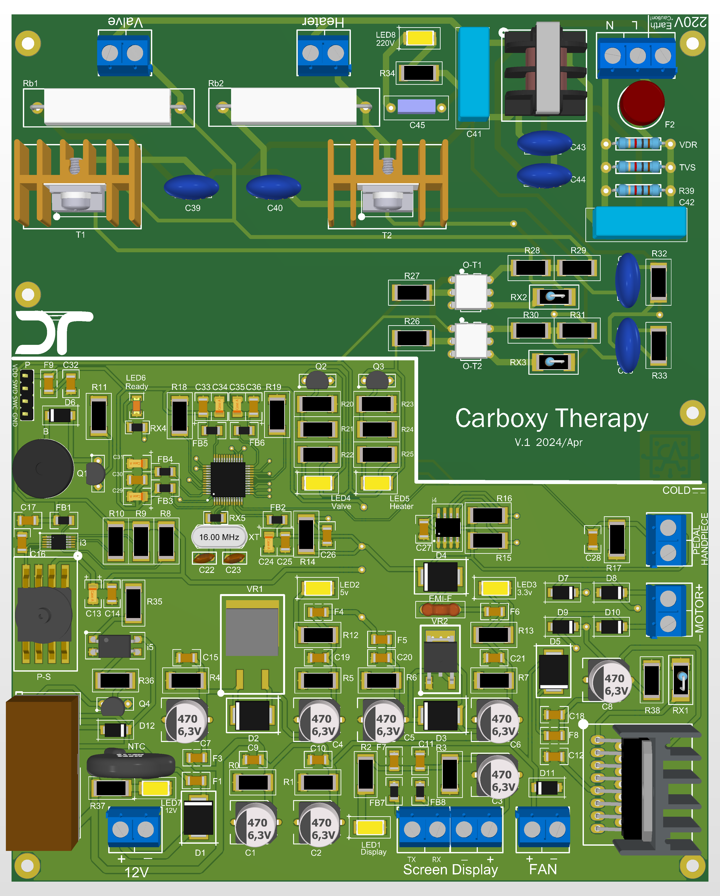
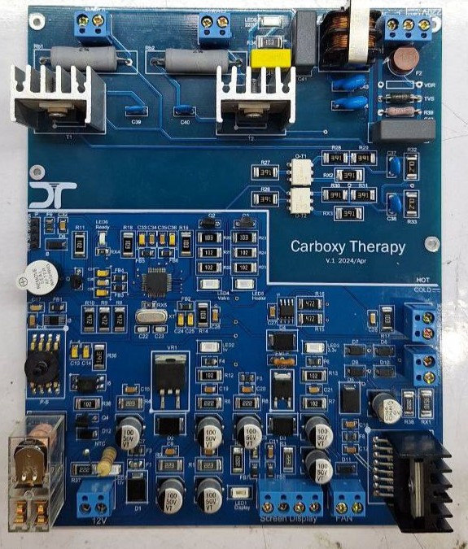
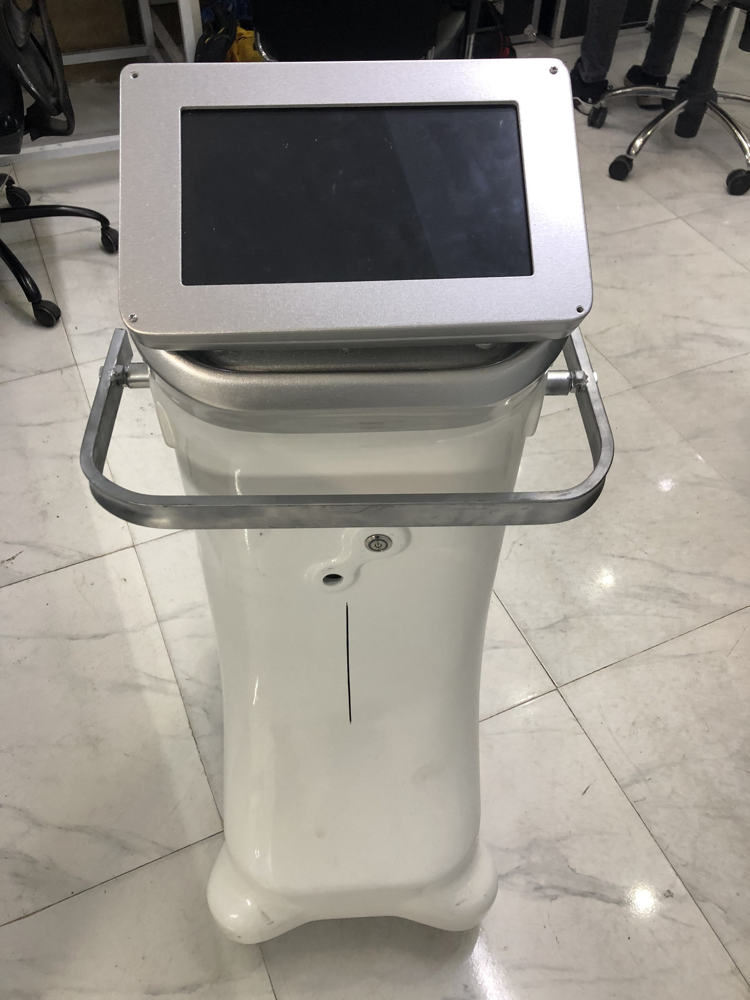
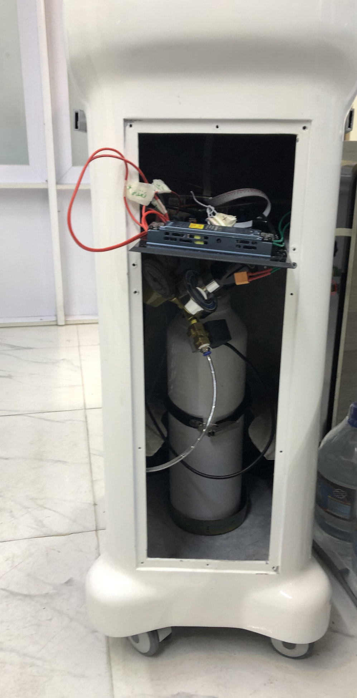

# Carboxytherapy Device — Electronics, Firmware and HMI Development

**Embedded Medical-Device Engineering · Independent Hardware and Firmware Development**  
*STM32-Based Control · CO₂ Delivery Monitoring · Motorized Valve Regulation · Touchscreen HMI*

## Overview

This project documents the **end-to-end electronics and embedded-control development of a carboxytherapy device**, including custom PCB circuitry, STM32 firmware, a touchscreen human–machine interface (HMI), actuator control, pressure sensing, calibration, and fault monitoring.

A carboxytherapy device is designed to administer controlled quantities of medical carbon dioxide (CO₂) through a clinical delivery system. The engineering challenge is to coordinate the requested delivery volume, pressure, and duration with real-time sensing and protective responses to abnormal operating conditions.

The device was designed, assembled, programmed, integrated, and tested by **Mostafa Amiri**. The repository presents the implemented engineering work using the available source code, PCB images, HMI screens, and device photographs. It does not provide clinical operating instructions or evidence of regulatory approval.

## System Architecture

The central **STM32F103-based controller** coordinates the user interface, pressure-measurement electronics, motor-driven valve adjustment, control timing, actuator outputs, and fault/status reporting.

| Subsystem | Engineering role |
| --- | --- |
| **CO₂ supply and delivery path** | Gas cartridge/cylinder, controlled valve, and injection interface |
| **Pressure acquisition** | Feedback from the gas-pressure sensor through an ADS1115 external ADC over I²C |
| **Motor and valve actuation** | MCU-controlled PWM and direction signals for motorized pressure/valve adjustment |
| **Delivery control** | User-selected volume, pressure, time, and program settings managed by the firmware |
| **Protection and diagnostics** | Pressure-limit monitoring, pressure-anomaly detection, timing/fault handling, and status indications |
| **Touchscreen HMI** | DWIN/DGUS interface connected to the controller through UART with DMA |
| **Additional hardware** | Heater and UV-related subsystems reported as part of the device design |

## Hardware Development and Integration

The electronics were developed around a custom main PCB combining controller interfaces, power and actuation circuitry, sensor connections, and supporting components. The images below show the PCB design visualization and assembled hardware.

  
  

<em>Custom electronic control board: PCB 3D representation (left) and assembled board (right).</em>

The physical prototype also includes the enclosure, gas supply arrangement, touchscreen, internal electrical wiring, and sensor/actuator integration.

[Explore the hardware documentation](hardware/README.md).

## Device Integration and Testing

The assembled prototype and internal integration are documented below. The developer reports that the complete system was functionally tested, including control and protective behaviors; formal validation data and regulatory certification records were not included in the supplied archive.

  
  

<em>Integrated prototype (left) and internal mechanical and electrical assembly (right).</em>

## Engineering Contributions

- **Electronic hardware:** custom PCB design, analog/digital circuitry, power and actuator interfaces, and integration into the assembled device.
- **STM32 firmware:** embedded C development for peripheral acquisition, motor/PWM control, touchscreen communication, operating modes, and calibration.
- **Pressure-feedback control:** acquisition of pressure measurements and adjustment of the motor-driven valve mechanism.
- **Safety-oriented control:** implemented overpressure and pressure-anomaly responses, fault/status handling, and control-interruption logic; additional temperature and electrical protection functions were reported by the developer.
- **Automatic calibration:** motor/valve calibration and readiness-state handling integrated with device operation.
- **HMI development:** touchscreen layouts, operating screens, mode selection, and controller–display data exchange.
- **Prototype integration:** physical assembly, subsystem integration, troubleshooting, and reported functional testing.

## Repository Sections

| Section | Description |
| --- | --- |
| **[Hardware](hardware/README.md)** | Custom PCB render, assembled boards, hardware integration, sensors, motor/valve electronics, and enclosure photographs. |
| **[Embedded Firmware](firmware/README.md)** | Original STM32F103 C source, CubeMX configuration, Keil project files, HAL/CMSIS dependencies, and firmware architecture. |
| **[HMI Development](hmi/README.md)** | DWIN touchscreen screens, treatment-mode navigation, information display, and HMI editor screenshots. |
| **[Results and Media](results-and-media/README.md)** | Assembled device and photographic evidence of the integrated prototype. |

## Copyright and Citation

Copyright © 2026 Mostafa Amiri. All rights reserved.

This repository is publicly accessible for research visibility and professional portfolio purposes. **No general open-source license is granted for the original project materials.** Third-party STM32 HAL/CMSIS components retain their respective licenses.

For reuse permissions, see [Copyright and Permissions](COPYRIGHT.md). For academic attribution, see [CITATION.cff](CITATION.cff).

---

**Electronics, firmware, HMI development, and system integration:** [Mostafa Amiri](https://github.com/Mostafaa-Amiri).
