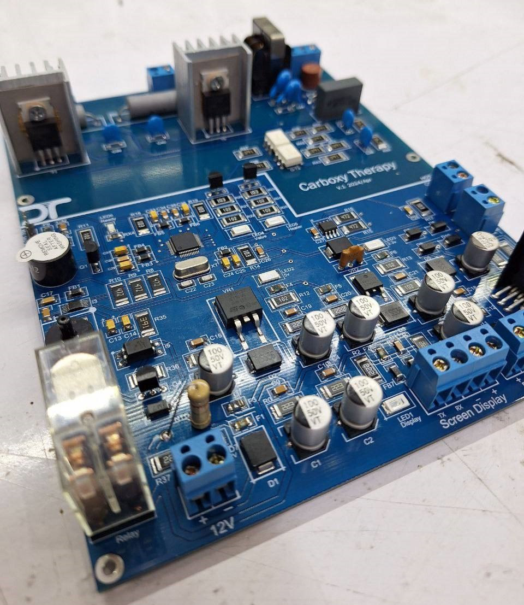
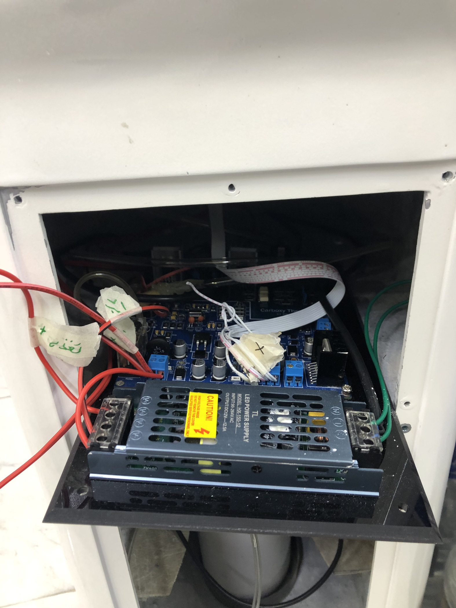

# Hardware Development — Carboxytherapy Device

[← Back to Project Overview](../README.md)

## Overview

This section documents the custom electronic control board and its integration into the carboxytherapy device, from PCB design visualization and board assembly to the installed electrical and gas-control hardware.

The hardware was designed and integrated by me. This public repository includes selected images and photographs.
## System Architecture

The electronic platform interfaces the STM32 controller with pressure sensing, motor/valve drive circuitry, touchscreen communications, power distribution, and device controls. The gas system includes a CO₂ supply, controlled valve, and pressure-monitoring path. A heater and UV-related hardware are also considered.

## Design and Implementation

### Custom Main PCB

*Altium-generated 3D visualization of the custom control PCB.*

  
  

<em>Assembled control electronics, showing power, sensing, and actuator interface components.</em>

### Pressure Sensing and Actuation

The firmware uses an **ADS1115 I²C ADC** to acquire pressure feedback. Motor-drive signals are generated by STM32 timer/PWM logic, with direction control provided through GPIO signals. This enables controlled mechanical adjustment of the valve/pressure mechanism and calibration toward requested operating conditions.

### Mechanical and Electrical Integration

  
  

<em>Internal equipment integration, including electronic boards, wiring, gas-related components, and mechanical assembly.</em>

## Related Documentation

- [Embedded Firmware](../firmware/README.md)
- [HMI Development](../hmi/README.md)
