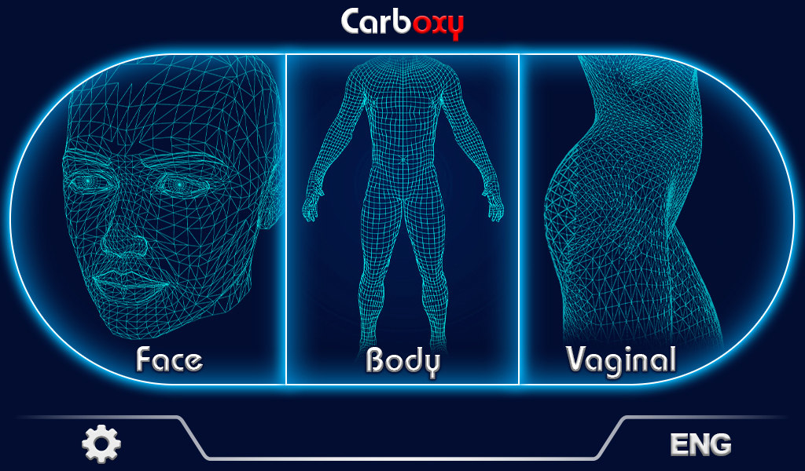
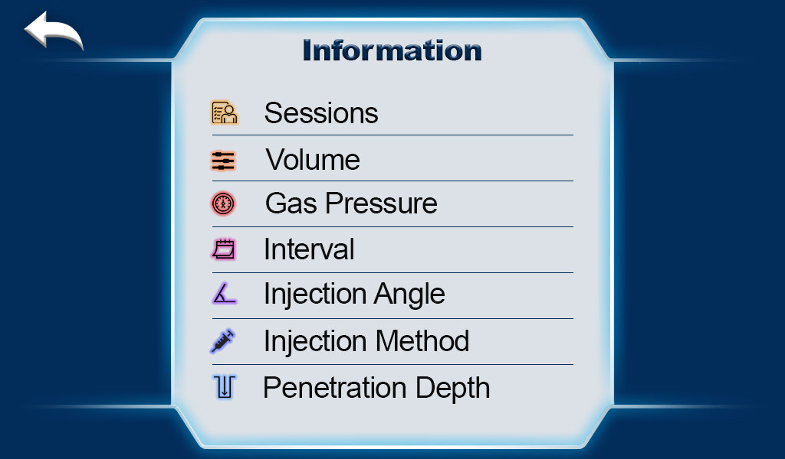
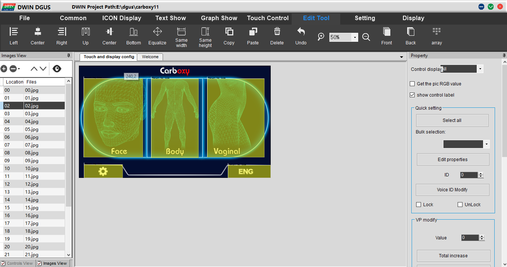
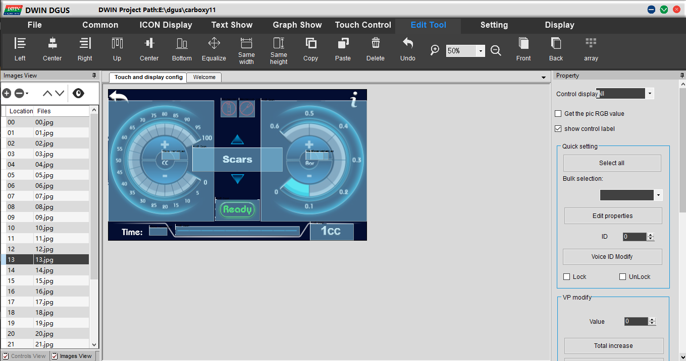

# HMI Development — Carboxytherapy Device

[← Back to Project Overview](../README.md)

## Overview

This section documents the touchscreen human–machine interface (HMI) developed for the carboxytherapy device. The available screenshots show the device interface and the DWIN DGUS editing environment used for screen development.

The display connects to the STM32 controller through a UART-based protocol, allowing operator selections, status information, and fault indications to be exchanged with the application firmware.

## System Architecture

The HMI organizes operator interaction into visual program selection, device operation and information screens, and controller-driven status/alert states. The firmware includes packet-based display writes and reception of user control values.

## Design and Implementation

### Screen Design and Navigation

  
  

<em>Branded device interface and program-selection navigation.</em>

*On-screen information categories including sessions, volume, gas pressure, interval, and procedure-related parameters.*

### HMI Editor Screenshots

  
  

<em>Screen layout and interface development in the DWIN DGUS design environment.</em>

The editable native HMI project is not part of the uploaded material; these screenshots document the interface design.

## Results and Experimental Evaluation

The screenshots demonstrate the implemented interface design and device-specific screens. The supplied material does not include independent usability testing or a clinical human-factors evaluation.

## Related Documentation

- [Embedded Firmware](../firmware/README.md)
- [Hardware Development](../hardware/README.md)
- [Results and Media](../results-and-media/README.md)
